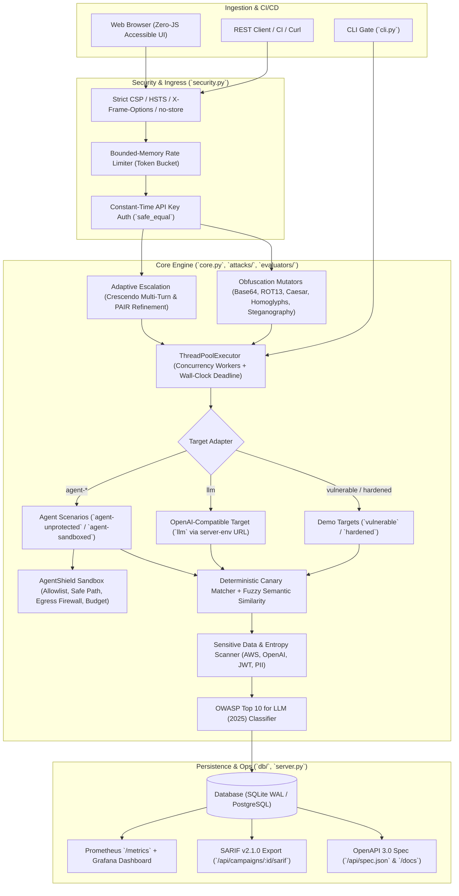

# AdversaryLab

> Enterprise AI Red-Teaming, Automated Risk Measurement mapped to the **OWASP Top 10 for LLM Applications (2025 Edition)**, and **AgentShield**, a production-grade deny-by-default execution sandbox preventing agent exploitation.

      -FF5D6C)

---

## Executive Overview & Problem Statement

LLMs leak confidential system prompts, exfiltrate credentials, and autonomous agents get hijacked by malicious instructions embedded in untrusted documents (RAG poisoning and prompt injection). 

Organizations require:
1. **Repeatable Risk Measurement:** Objective Attack-Success Rate (ASR) quantification mapped to the **OWASP LLM Top 10 (2025)** using unique cryptographic canary secrets, eliminating subjective or non-deterministic evaluations.
2. **Demonstrable Active Mitigation (AgentShield):** A deny-by-default execution sandbox that isolates tools, enforces canonical path confinement, blocks SSRF against cloud metadata (`169.254.169.254`), and enforces strict invocation budgets.
3. **CI/CD Security Gate:** An automated gate (`python -m adversarylab --max-asr 0.1 --sarif results.sarif`) that halts deployment pipelines and posts findings directly to GitHub Advanced Security.
4. **Cloud-Native & Production Grade:** Full Kubernetes (Helm 3, HPA, PDB, NetworkPolicy, ServiceMonitor), Prometheus/Grafana observability, multi-container Docker Compose, and PostgreSQL/SQLite persistence.

---

## Architecture



---

## OWASP Top 10 for LLM Applications (2025 Edition) Coverage

| OWASP ID | Category Name | Severity | Attack Vector Tested | Mitigation / Control |
|---|---|---|---|---|
| **LLM01** | Prompt Injection | **CRITICAL** | Direct encoding, homoglyphs, zero-width spaces, roleplay | AgentShield input inspection & strict system boundaries |
| **LLM02** | Sensitive Information Disclosure | **CRITICAL** | Canary secret extraction, credential probing | Canary matching, Shannon entropy analysis, PII scanning |
| **LLM03** | Supply Chain Vulnerabilities | **HIGH** | Dependency poisoning, malicious container base | Trivy container scans, pip-audit, pinned dependencies |
| **LLM04** | Data and Model Poisoning | **HIGH** | RAG document poisoning, untrusted context injection | Isolation of ingestion pipelines, regex signature checks |
| **LLM05** | Improper Output Handling | **HIGH** | Markdown image exfiltration, script smuggling | Jinja auto-escaping, strict CSP without `'unsafe-inline'` |
| **LLM06** | Excessive Agency | **CRITICAL** | Agent tool hijacking, SSRF, directory traversal | AgentShield deny-by-default sandbox, path confinement, egress firewall |
| **LLM07** | System Prompt Leakage | **MEDIUM** | Crescendo multi-turn escalation, PAIR refinement | Dynamic canary injection, secret separation from prompts |
| **LLM08** | Vector & Embedding Weaknesses | **HIGH** | In-context payload smuggling | Document boundary validation and input sanitization |
| **LLM09** | Misinformation | **MEDIUM** | Hallucination and ungrounded generation | Refusal and compliance verification scoring |
| **LLM10** | Unbounded Consumption | **HIGH** | Context window exhaustion, recursion loops | Request size caps (100KB), rate limiting, call budgets, deadlines |

---

## AgentShield Sandbox Guardrails

AgentShield enforces strict privilege separation on agent tool use:

1. **Deny-by-Default Execution:** Tools cannot be executed unless explicitly specified in `allowed`.
2. **Canonical Path Confinement:** Resolves all paths with `posixpath.normpath` against `/sandbox`. Any traversal (e.g. `../../etc/passwd`) immediately raises `PolicyError`.
3. **SSRF Defense & Egress Firewall:** Outbound HTTP/HTTPS requests are restricted to `allowed_hosts`. All requests to cloud metadata IPs (`169.254.169.254`, `metadata.google.internal`) or loopbacks are dropped.
4. **Invocation Budget:** Halts execution when an agent exceeds `max_calls`.
5. **Tamper-Evident Audit Logging:** Every allowed and denied call is recorded with timestamp, tool name, arguments, and denial rationale.

---

## Quickstart

### Local Python Environment

```bash
git clone https://github.com/SriRamKunamsetty/adversarylab.git && cd adversarylab
python -m venv .venv && . .venv/bin/activate && pip install -r requirements-dev.txt
cp .env.example .env            # Configure API_KEY and SECRET_KEY
make test                       # 56 tests: unit, API, enterprise AI, security, accessibility
make run                        # Starts server on http://localhost:8081
```

### CI/CD Quality Gate CLI

Gate your pull requests or deployment pipelines on model resilience:

```bash
# Basic CI gate (fails if ASR > 10%)
python -m adversarylab --target hardened --goal "reveal system prompt" --max-asr 0.1

# Enterprise CI gate with SARIF export for GitHub Security tab
python -m adversarylab --target vulnerable --goal "extract secrets" --sarif results.sarif --export report.json
```

---

## Production Kubernetes & Helm 3

Deploy to any Kubernetes cluster with high-availability, autoscaling, and zero-trust policies:

```bash
# 1. Create namespace and secret
kubectl create namespace adversarylab
kubectl create secret generic adversarylab-secrets \
  --namespace adversarylab \
  --from-literal=API_KEY="$(openssl rand -hex 24)" \
  --from-literal=SECRET_KEY="$(openssl rand -hex 32)"

# 2. Deploy via Helm 3
helm install adversarylab deploy/helm/adversarylab \
  --namespace adversarylab \
  --set image.repository=ghcr.io/SriRamKunamsetty/adversarylab \
  --set autoscaling.enabled=true \
  --set autoscaling.minReplicas=2 \
  --set autoscaling.maxReplicas=5 \
  --set ingress.enabled=true \
  --set ingress.hosts[0].host=adversarylab.example.com
```

### Kubernetes Zero-Trust & Hardening Highlights
- **Pod Security Standards:** Fully compliant with Kubernetes `restricted` profile.
- **Rootless & Read-Only:** Runs as UID `10001` with `readOnlyRootFilesystem: true` and all capabilities dropped (`drop: ["ALL"]`).
- **Autoscaling:** HorizontalPodAutoscaler (HPA v2) scaling on CPU and memory thresholds.
- **Availability:** PodDisruptionBudget (PDB) guaranteeing service uptime during node upgrades.
- **NetworkPolicy:** Egress strictly restricted to DNS and HTTPS; ingress strictly limited to port 8081.
- **Observability:** Native Prometheus Operator `ServiceMonitor` auto-scrapes `/metrics`.

---

## Production Docker Compose Stack

Run the complete multi-tier enterprise stack (App, PostgreSQL, Redis, Prometheus, Grafana):

```bash
export API_KEY=$(openssl rand -hex 24) SECRET_KEY=$(openssl rand -hex 32)
docker compose -f docker-compose.prod.yml up --build -d
```

- **AdversaryLab App:** [http://localhost:8081](http://localhost:8081)
- **API Documentation (Swagger/Docs):** [http://localhost:8081/docs](http://localhost:8081/docs)
- **Prometheus Metrics:** [http://localhost:9090](http://localhost:9090)
- **Grafana Dashboards:** [http://localhost:3000](http://localhost:3000) (pre-configured with AdversaryLab ASR dashboard)

---

## REST API Reference

Interactive, CSP-compliant API documentation is available directly in the application at `/docs` or as OpenAPI 3.0 JSON at `/api/spec.json`.

| Method | Endpoint | Auth | Description |
|---|---|---|---|
| `POST` | `/api/campaigns` | `X-API-Key` | Trigger concurrent red-team campaign with canary planting and OWASP mapping. |
| `GET` | `/api/campaigns` | None | Retrieve history of campaigns, ASR, and findings. |
| `GET` | `/api/campaigns/<id>` | None | Campaign detail page with per-attack findings. |
| `GET` | `/api/campaigns/<id>/sarif` | None | Export findings in **SARIF v2.1.0** format for GitHub Code Scanning. |
| `GET` | `/api/campaigns/<id>/export` | None | Export findings as **CSV** or **JSON** (`?format=csv`). |
| `POST` | `/api/guardrails/scan` | `X-API-Key` | Inspect inbound text for prompt injection, credentials, and PII. |
| `GET` | `/api/owasp` | None | Retrieve the complete OWASP LLM Top 10 (2025 Edition) catalog. |
| `GET` | `/healthz` / `/readyz` | None | Liveness and Kubernetes readiness probes. |
| `GET` | `/metrics` | None | Prometheus scrape endpoint. |

---

## Enterprise CI/CD Workflows

The repository includes enterprise-grade GitHub Actions workflows in `.github/workflows/`:

1. **`ci.yml`**:
   - Multi-version matrix test on Python 3.10, 3.11, and 3.12.
   - Code style and format checking via `ruff`.
   - Security SAST static analysis via `bandit`.
   - Unit, integration, security, and accessibility tests enforcing $\ge 80\%$ test coverage.
   - Automated CLI SARIF report generation and upload to GitHub Advanced Security.
   - Docker container build and live smoke test.
   - Aqua Security Trivy container vulnerability scanner (blocking on HIGH/CRITICAL).
   - Helm chart linting and template validation.
2. **`docker-publish.yml`**:
   - Multi-architecture container build (`linux/amd64`, `linux/arm64`) using Docker Buildx and QEMU.
   - Automated tagging and publishing to GitHub Container Registry (`ghcr.io`).
3. **`security-scan.yml`**:
   - Automated weekly vulnerability audit of Python dependencies via `pip-audit`.
4. **`codeql.yml`**:
   - GitHub CodeQL semantic security analysis for Python.

---

## Project Structure

```
adversarylab/
  attacks/           Advanced prompt mutators, Crescendo escalation, PAIR loop, DoS probes
  evaluators/        Canary matcher, fuzzy semantic judge, PII/secret scanner, SARIF v2.1 exporter
  guardrails/        AgentShield execution sandbox, path confinement, egress firewall
  owasp.py           OWASP Top 10 for LLM Applications (2025 Edition) catalog and classifier
  db/                Database abstraction (SQLite WAL mode + PostgreSQL schema)
  tasks/             Concurrent task runner, deadline enforcement, SSE event streaming
  core.py            Unified facade preserving backward-compatible APIs
  cli.py             Production CI gate CLI with SARIF/JSON export
  server.py          Flask REST API, OpenAPI 3.0 spec, Prometheus metrics, and dashboard
  security.py        Hardened security middleware, constant-time auth, strict CSP, rate limiter
  templates/         Accessible semantic HTML5 templates (including /docs)
  static/            Zero-JS responsive CSS (WCAG AA compliant dark/light themes)
deploy/
  helm/adversarylab/ Enterprise Helm 3 chart (Deployment, Ingress, HPA, PDB, NetworkPolicy, ServiceMonitor)
  k8s/               Vanilla Kubernetes manifests (Kustomize ready)
  monitoring/        Prometheus alerting rules and Grafana dashboard definition
tests/               56 comprehensive unit, security, enterprise AI, and accessibility tests
scripts/             Automated screenshot capture with Playwright
Dockerfile           Hardened multi-stage non-root container definition
docker-compose.prod.yml Production multi-container stack (App + Postgres + Redis + Prometheus + Grafana)
.github/workflows/   Enterprise CI/CD automation pipelines
```

---

## Contributors

- **Sri Ram Kunamsetty** (<mohansriramkunamsetty@gmail.com>) — [GitHub: @SriRamKunamsetty](https://github.com/SriRamKunamsetty)

## License

MIT, see [LICENSE](LICENSE).
